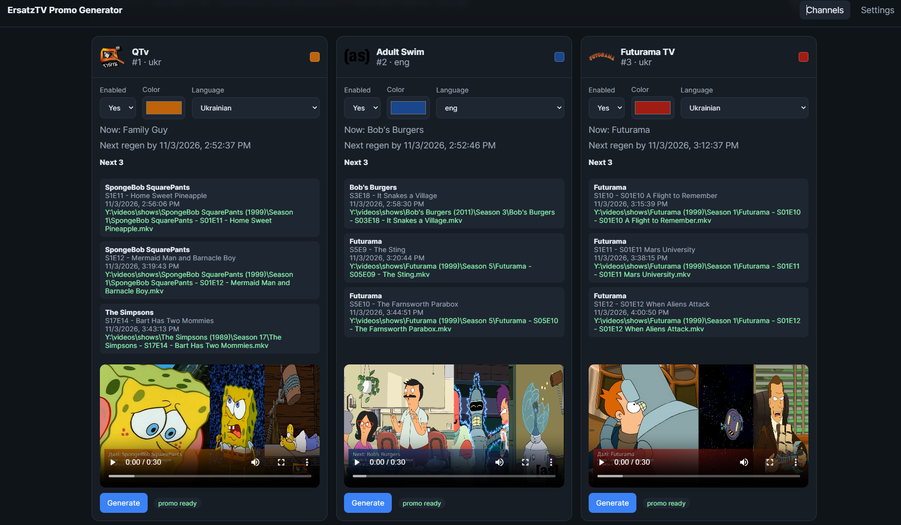

# ErsatzTV Promo Generator

Generate short **“next up” promos** for [ErsatzTV](https://ersatztv.org/) channels: animated panels, lower-third titles, optional multilingual voice-over, auto-regen before the current item ends, and one-click **Push** into ErsatzTV as fillers.

Designed to run primarily in **Docker** next to ErsatzTV, with the same media and config folders mounted into both containers.

| Items in promo | Duration | Layout |
|---|---|---|
| 1 | 10s | Full frame |
| 2 | 20s | Focused **75%** / other **25%** |
| 3 | 30s | Focused **50%** / others **25%** (default) |

Each promo is written as `{output}/{channel}/next-items.mp4`.



> Dashboard preview

https://github.com/user-attachments/assets/b4490290-5439-4899-9a0a-52f66f6b4f15

> Example of generated file [next-items.mp4](./assets/readme/next-items.mp4)

---

## Features

| Area | What you get |
|---|---|
| **Video** | 1–3 upcoming primary items, animated focus transitions |
| **Graphics** | Channel logo, color lower-third, localized “Next / After that” + start time |
| **Voice** | Piper (Wyoming) preferred; Edge TTS then Windows SAPI fallbacks |
| **Audio** | Optional original-item bed (volume + mute-until-VO-ends) |
| **Automation** | VO prewarm when a new primary starts (+ look-ahead); live MPEG-TS at play time |
| **Push** | Remote Stream YAML + per-channel collections + classic-schedule fillers |

---

## Requirements

- **Docker** (recommended) **or** Node.js 20+ with ffmpeg/ffprobe
- ErsatzTV with:
  - HTTP API (URL + API key)
  - Readable `ersatztv.sqlite3`
  - Media files reachable from this app (see [Paths & Docker mounts](#paths--docker-mounts))
- Optional: **Wyoming Piper** for local TTS (e.g. Home Assistant add-on on port `10200`)

---

## Quick start (Docker / production)

Published image: [`ghcr.io/dbondarchuk/tv-promo-generator`](https://github.com/dbondarchuk/tv-promo-generator/pkgs/container/tv-promo-generator)

1. Point host folders at your media, promo output, and ErsatzTV config (env vars or defaults in [`docker-compose.yml`](docker-compose.yml)).
2. Start:

```bash
docker compose up -d
```

3. Open **http://localhost:5174** → **Settings** and fill ErsatzTV + paths (see below).
4. Open **Channels**, enable channels, optionally **Warm VO**, then **Push to ErsatzTV** when ready.

If the app is not configured yet, Channels shows a setup prompt linking to Settings. `config/settings.json` is created automatically on first start.

### Local image build

Use the build compose file instead of pulling GHCR:

```bash
docker compose -f docker-compose.build.yml up -d --build
```

---

## Paths & Docker mounts

This app and ErsatzTV usually see the **same files under different paths**. Settings must use paths **inside this container**, matching the mounts in [`docker-compose.yml`](docker-compose.yml).

### Default compose mounts

| Host (examples) | Inside promo-generator | Typical Settings value |
|---|---|---|
| `$MEDIA_PATH` / `./media` | `/library` (read-only) | Library path = `/library` |
| `$PROMO_PATH` / `./output` | `/data/output` | Output path = `/data/output` |
| same promo folder | `/promos` | ErsatzTV library path = `/promos` |
| `$ETV_CONFIG_PATH` / `./etv-config` | `/etv-config` | Database = `/etv-config/ersatztv.sqlite3` |
| `$CONFIG_PATH` / `./config` | `/data/config` | (process only — not in UI) |
| `$CACHE_PATH` / `./cache` | `/data/cache` | (process only — not in UI) |

Mount the **same host promo folder** into ErsatzTV at whatever path ETV uses for that library (often also `/promos` or a NAS path). Push registers files using **ErsatzTV library path**.

### Path rewrite (library media)

Playout rows in `ersatztv.sqlite3` store media paths as **ErsatzTV sees them** (e.g. `/media/shows/...`). This container reads the same files under **Library path** (e.g. `/library`).

| Setting | What to put |
|---|---|
| **ErsatzTV path prefix** | Leading path as stored in the DB (e.g. `/media`) |
| **Library path** | Where those files appear in *this* container (e.g. `/library`) |

**Example:** DB path `/media/shows/Foo/s01e01.mkv`  
→ prefix `/media`, library `/library`  
→ opens `/library/shows/Foo/s01e01.mkv`.

If the DB already stores paths that exist as-is inside this container, leave the prefix empty and set Library path to that root.

### Promo output vs ErsatzTV library path

| Setting | Role |
|---|---|
| **Output path** | Where this app **writes** `{channel}/next-items.yml` (e.g. `/data/output`) |
| **ErsatzTV library path** | Same folder **as ErsatzTV sees it** (e.g. `/media/videos/promos`) — Remote Streams library registration / scan |
| **On-demand base URL** | How ErsatzTV reaches this app (e.g. `http://tv-promo-generator:5174`) |

Mount the same host folder into both containers (different path strings are fine). Air playback is live HTTP MPEG-TS; use **Preview live** on Channels for browser preview.

---

## Settings (UI)

Stored in `config/settings.json`. Port, cache, config path, log level, and ffmpeg binaries are **environment-only** (see [Environment](#environment-process-only)).

### ErsatzTV

| Setting | Description |
|---|---|
| **ErsatzTV URL** | Base URL of the ErsatzTV HTTP API (e.g. `http://ersatztv:8409` on a Docker network, or `http://host.docker.internal:8409`) |
| **API key** | Value of `X-Etv-Api-Key` from ErsatzTV (`api-secrets.json`) |
| **ersatztv.sqlite3 path** | SQLite DB inside this container (e.g. `/etv-config/ersatztv.sqlite3`) — needed for playouts, paths, and Push |
| **Library path** | Root where this app can read channel media (e.g. `/library`) |
| **ErsatzTV path prefix** | DB path prefix rewritten to Library path (see above); empty if no rewrite |
| **Output path** | Directory for generated promos (e.g. `/data/output`) |
| **ErsatzTV library path** | Promo folder as ErsatzTV sees it (e.g. `/promos`) |
| **On-demand base URL** | Base URL ErsatzTV uses for live promos (must be reachable from the ETV container) |
| **ErsatzTV library path** | Same promo folder as ETV sees (Remote Streams library); empty → output path |
| **Regen lead time (minutes)** | Legacy setting (VO now warms at current-item start) |
| **Display timezone** | IANA zone for on-screen / spoken start times (e.g. `America/New_York`). Empty → use `TIME_ZONE` / `TZ` env |

### Encoding

| Setting | Description |
|---|---|
| **Hardware acceleration** | `None` (CPU), or `Nvenc` / `Qsv` / `Vaapi` / `Amf` / `VideoToolbox` when the container has the matching device |
| **Video codec** | `H264` or `Hevc` |
| **Resolution** | Output frame size, e.g. `1920x1080` |
| **Video bitrate (kbps)** | Target video bitrate |
| **Audio bitrate (kbps)** | AAC bitrate for the promo |
| **Video preset** | Encoder preset (e.g. `medium`) |
| **Video profile** | Encoder profile (e.g. `high`) |
| **VAAPI device** | Device node when using Vaapi (e.g. `/dev/dri/renderD128`) |
| **VAAPI driver** | `Default` or a named driver (`iHD`, `i965`, …) |
| **VAAPI display** | Usually `drm` in Docker |

### Graphics

| Setting | Description |
|---|---|
| **Items in promo** | `1` / `2` / `3` upcoming items → `10s` / `20s` / `30s` |
| **Lower-third width** | **Follow focused item** (bar slides with the 50%/75% panel) or **Full width, fixed left** |

### Audio

| Setting | Description |
|---|---|
| **Original item volume** | `0` = skip source audio (VO/silence only). `1–100` = mix clip audio at that % |
| **Play original audio after voice-over** | When volume &gt; 0: **On** mutes source until each item’s VO ends, then plays until the phase ends; **Off** mixes under VO |

### Voice

| Setting | Description |
|---|---|
| **Enable voice-over** | Master switch for spoken cues |
| **Voice provider** | `Auto` (Piper → Edge → SAPI), or force Piper / Edge / Windows SAPI |
| **Show voice detail** | How much episode info to speak after the show name |
| **Cue→title pause (ms)** | Silence between “Next on …” / “After that” and the title |
| **TTS timeout (ms)** | Per synthesis attempt timeout |
| **Piper URL** | Wyoming Piper base URL (e.g. `http://192.168.0.151:10200`) |
| **Default Piper voice / speaker** | Used when no language override is set |
| **Language overrides** | Per channel-language Piper voice and speaker (empty = default / auto) |

Use **Validate settings** to check paths, DB, ffmpeg, and API connectivity. **Reset to defaults** rewrites `settings.json`.

---

## Using the UI

1. **Settings** — configure ErsatzTV + paths, then Validate / Save.
2. **Channels** — list from ErsatzTV; toggle **enabled**; optional per-channel language and color.
3. **Preview live** — on-demand MPEG-TS/fMP4 encode of the current next-up set.
4. **Warm VO** / **Warm VO all** — pre-synthesize voice (when voice-over is enabled); the scheduler also warms VO when a new primary starts.
5. **Push to ErsatzTV** — choose filler slots (pre / middle / post / tail) and cleanup options.
6. **Rollback DB** — restore the last pre-push SQLite backup if needed.

Per-channel language drives overlays and VO templates (e.g. `uk` → Ukrainian).

---

## Promo layout & voice

- Phases are ~10s each, with **1.5s** smooth width transitions between items.
- Lower-third: `Next: {title}` / `After that: {title}`, optional episode line, start time.
- Movie years like `(2021)` are stripped from display and speech.
- Spoken pattern: cue → pause → title (+ season/episode per **Show voice detail**).
- Engine order (Auto): Piper → Edge TTS → Windows SAPI.

---

## Live promos (on-demand)

ErsatzTV plays fillers from a **Remote Stream** that points at this app:

```yml
url: http://tv-promo-generator:5174/live/{channelNumber}/promo.ts
is_live: true
duration: 00:00:30
```

When ETV opens the URL, this app live-encodes the current “next up” set as **MPEG-TS** over HTTP. Voice-over is pre-warmed in the background; if VO is not cached yet, the stream still starts **without VO** (never blocks air on TTS).

### VO prewarm + cache

- Scheduler detects a **new current primary** and enqueues a **vo-prewarm** job for the next-N window and a +1 look-ahead.
- WAV files live under `{cache}/voice/` with a per-channel ledger; only the last few currents are kept (older hashes are deleted).

---

## Push to ErsatzTV

**Push** runs as a job (pauses generate / VO prewarm):

1. Writes per-channel `next-items.yml` under Output path (URL = on-demand base + `/live/...`)
2. Creates/updates Remote Stream library **Promo Generator Streams** at ErsatzTV library path
3. Scans the library
4. Upserts manual collection `Promo Generator - Next - {channel name}` with that channel’s `.yml` media item
5. Upserts typed filler presets and wires selected schedule slots (pre / middle / post / tail)
6. Optionally cleans legacy / unselected fillers
7. Resets the channel playout

Requires **On-demand base URL**. Skipped when the playout is not classic, or the schedule is shared by multiple channels.

> Push writes to `ersatztv.sqlite3` and resets playouts — confirm before running in production. Requires ErsatzTV with Remote Streams support.

---

## Environment (process only)

| Variable | Description |
|---|---|
| `PORT` | HTTP port (default `5174`) |
| `LOG_LEVEL` | `debug` \| `info` \| `warn` \| `error` |
| `CACHE_PATH` | Voice / encode work cache |
| `CONFIG_PATH` | Directory for `settings.json` + channel overrides |
| `FFMPEG_PATH` / `FFPROBE_PATH` | Optional absolute binaries |
| `TIME_ZONE` / `TZ` | Fallback when Settings → timezone is empty |

Compose also accepts host path overrides: `MEDIA_PATH`, `PROMO_PATH`, `ETV_CONFIG_PATH`, `CONFIG_PATH`, `CACHE_PATH`.

Hardware tips:

- **VAAPI / QSV** — uncomment `/dev/dri` in compose and set Hardware acceleration in Settings
- **NVENC** — uncomment the NVIDIA device reservation

UI + API are served together on port **5174**.

---

## Development (without Docker)

```bash
npm install
cp .env.example .env
npm run setup:ffmpeg
npm run build -w @promo/shared
npm run dev
```

| Service | URL |
|---|---|
| UI (Vite) | http://localhost:5173 |
| API | http://localhost:5174 |

```
client/          React UI
server/          Express API, jobs, ffmpeg, TTS, ErsatzTV
packages/shared/ Shared types & settings
config/          settings.json + channel overrides
output/          Generated promos
cache/           Voice cache + encode work dirs
```

```bash
npm run build        # shared → server → client
npm start            # production server (after build)
npm test
npm run typecheck
npm run lint         # ESLint + Prettier (hacado-style)
npm run lint:fix    # apply padding-lines / prettier fixes
npm run format       # Prettier write
```

---

## Troubleshooting

| Symptom | Likely fix |
|---|---|
| Setup required on Channels | Fill ErsatzTV URL, database, library path, and output path in Settings |
| `File not found` while generating | Check Library path + path prefix rewrite against DB paths |
| VO hangs / Edge 403 | Set a reachable Piper URL; Edge is optional |
| Push skipped | Classic playout only; shared schedules across channels are skipped; set On-demand base URL |
| Live stream 503 | Channel disabled / no upcoming items / media paths unreadable |
| Empty / wrong titles | DB / XMLTV metadata; confirm database path is readable |

Job logs on Channels show each encode step. Failed encodes leave `filter_complex.txt` under the job work dir in cache.
